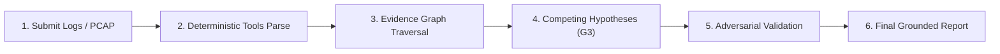

# ACIP: Comprehensive End-to-End User Manual & Learning Guide

Welcome to the **Agentic Cyber Investigation Platform (ACIP)**. This guide teaches you how to use every feature of ACIP from top to bottom, explaining what each screen, button, badge, and graph node does in the simplest, most intuitive manner.

---

## 1. What is ACIP? (In Plain English)

In modern cybersecurity, incident responders are overwhelmed by thousands of logs. When analysts ask typical AI systems (like ChatGPT) to analyze security logs, the AI often **hallucinates**—it invents fake IP addresses, fictitious vulnerabilities, or non-existent attack steps that sound completely convincing.

**ACIP solves this with a strict rule built into its architecture:**
> **Deterministic tools gather evidence. AI agents reason over evidence. AI is never the source of truth.**

If an AI agent tries to invent a claim that is not directly backed by raw logs, the platform physically rejects the claim and stops it from being written to the database.

---

## 2. Quickstart: Launching the System in 60 Seconds

You do not need any complex compiler or Node.js build step. The frontend is native HTML/CSS/JavaScript, and the backend is Python 3.12.

### Step 1: Start the Server
Open your terminal (PowerShell or Bash) in the project folder and run:

```bash
# Windows
.venv\Scripts\python.exe -m acip.cli serve

# Linux / macOS
.venv/bin/python -m acip.cli serve
```

### Step 2: Open Your Browser
* **Web User Interface**: Go to [http://127.0.0.1:8000/](http://127.0.0.1:8000/)
* **API Documentation**: Go to [http://127.0.0.1:8000/docs](http://127.0.0.1:8000/docs)

### Step 3: Log In
The system seeds a default local administrator account:
* **Username**: `admin`
* **Password**: `admin-password-change-me`

---

## 3. Step-by-Step Walkthrough: Running Your First Investigation



### Step 1: Create a New Investigation
1. Log in to the web interface.
2. Click the **"New Investigation"** button on the left sidebar.
3. Fill in the details:
   * **Title**: e.g., *"Suspicious SSH Activity on Web Server"*
   * **Target Type**: Select **Log** (or File, Text, PCAP, URL).
   * **Target Value**: Paste your raw log content. For example:
     ```text
     Mar 15 10:14:01 web01 sshd[2001]: Failed password for root from 198.51.100.99 port 41234 ssh2
     Mar 15 10:14:05 web01 sshd[2002]: Failed password for root from 198.51.100.99 port 41235 ssh2
     Mar 15 10:14:09 web01 sshd[2003]: Failed password for root from 198.51.100.99 port 41236 ssh2
     Mar 15 10:14:14 web01 sshd[2004]: Accepted password for root from 198.51.100.99 port 41237 ssh2
     Mar 15 10:14:22 web01 sudo[2010]: root : TTY=pts/1 ; PWD=/root ; USER=root ; COMMAND=/usr/bin/cat /etc/shadow
     ```
4. Click **"Start Investigation"**.

### Step 2: Watch Real-Time Execution
* ACIP automatically connects to a real-time **Server-Sent Events (SSE)** stream.
* A live progress bar will fill as specialized agents execute in sequence:
  `Triage` $\to$ `Log Analysis` $\to$ `MITRE Mapping` $\to$ `Correlation` $\to$ `Reasoning` $\to$ `Hypothesis` $\to$ `Validation` $\to$ `Reporting`.
* Every raw tool run and newly verified observation appears in the live feed without requiring a page refresh.

---

## 4. Visual UI Guide: What Every Element Does

Once an investigation completes, five interactive tabs become available across the top of your screen:

### Tab 1: Overview & Summary
* **Status Badge**: Shows whether the investigation is `COMPLETED`, `RUNNING`, or `FAILED`.
* **Investigation Risk Score**: A deterministic roll-up from 0.0 to 100.0 calculating threat severity.
* **Findings Feed**: Summarizes high-priority detections (e.g., *"SSH Brute-Force Credential Guessing"*, *"High-Risk Sudo Access to /etc/shadow"*).
* **Clickable Evidence Links**: Every claim has link badges (e.g., `EVD-01`, `EVD-02`). Clicking them immediately opens the exact log line that proved that finding.

### Tab 2: Evidence Graph (Interactive SVG Canvas)
The Evidence Graph visualizes all interconnected entities discovered in the evidence.

* **Nodes (Colored Circles)**:
  * 🔵 **IP Addresses** (e.g., `198.51.100.99`)
  * 🟢 **Users** (e.g., `root`, `alice`)
  * 🟣 **Hosts / Servers** (e.g., `web01`)
  * 🟠 **Commands / Processes** (e.g., `cat /etc/shadow`)
* **Edges (Connecting Arrows)**:
  * Directed arrows showing verified interactions (e.g., `AUTH_ATTEMPT`, `ESCALATES_TO`, `ACCESSES`).
  * **Crucial Invariant**: Every single arrow in the graph is linked to a non-null database evidence record. No edge is drawn based on pure AI speculation.
* **Filter Chips (`All`, `IP`, `User`, `Host`)**: Click to show or hide node categories to simplify large incident graphs.
* **Node Inspector (Right Drawer)**: Click any node to open the inspector, revealing when that entity was first seen, last seen, total observation counts, and all connected evidence items.

### Tab 3: Forensic Timeline
* **Chronological Rail**: Shows every event in exact chronological sequence.
* **Timestamp Badges**:
  * <span style="background-color:#166534; color:white; padding:2px 6px; border-radius:4px; font-weight:bold;">EXACT</span>: The timestamp was parsed directly from structured ISO log records.
  * <span style="background-color:#854d0e; color:white; padding:2px 6px; border-radius:4px; font-weight:bold;">APPROXIMATE</span>: The timestamp is relative or inferred from file ingestion metadata.
* Helps analysts reconstruct the attacker's timeline with zero guesswork.

### Tab 4: Competing Hypotheses & Validation
Instead of providing a single, unquestioned narrative, ACIP presents competing hypotheses:
* **Primary Hypothesis**: Explains the data as an active intrusion (e.g., *"Coordinated brute-force intrusion aiming to exfiltrate credentials"*).
* **Alternative Hypothesis**: Explains the data as benign activity (e.g., *"Authorized internal administration script or automated test loop"*).
* **Falsification Condition (Invariant G3)**: Every hypothesis card states what specific evidence would disprove it.
* **Resolution Badges**:
  * <span style="color:#15803d; font-weight:bold;">SUPPORTED</span>: Grounded attack evidence confirms this hypothesis.
  * <span style="color:#b91c1c; font-weight:bold;">REFUTED</span>: Definitively disproven by contradicting evidence.

### Tab 5: Generated Investigation Report
* Generates an auditable Markdown report ready to export to SOC managers or legal teams.
* Discloses the model used, token consumption, tools executed, and explicit retention states.

---

## 5. What is the "About & Limitations" Button?

In the top right navigation bar, click **"About & Limitations"**.

This opens a native dialog displaying live information from `/capabilities`:
1. **What ACIP CAN do**: Supported parsers (Linux auth logs, Web access logs, PCAP, IOC extraction, MITRE mapping).
2. **What ACIP CANNOT do**: Explicitly warns the user that it does not currently parse encrypted TLS sessions without keys, memory dumps (Volatility), or obfuscated compiled binaries.

> [!TIP]
> **Why this matters for examiners & users:** Most AI tools pretend they can analyze everything. ACIP exercises *epistemic honesty*—it explicitly warns you when an artifact format is unsupported so you never mistake a missing parser for a clean system.

---

## 6. Command Line Interface (CLI) Guide

For power users, administrators, and researchers, ACIP includes a full CLI suite:

### Start the Server
```bash
python -m acip.cli serve --host 127.0.0.1 --port 8000
```

### Check Honest System Capabilities
```bash
python -m acip.cli capabilities
```

### Create a New User Account
```bash
python -m acip.cli create-user bob --role investigator --email bob@example.com
```

### Create and Verify Backups
```bash
# Create an integrity-checked backup archive
python -m acip.cli backup ./backups/acip_backup.tar.gz

# Restore from backup into empty storage
python -m acip.cli restore ./backups/acip_backup.tar.gz
```

### Run Evaluation Benchmarks
```bash
python -m acip.cli benchmark --condition all --output-dir experiments/results
```
Runs the evaluation matrix across all baseline conditions (Rules, Single LLM, Multi-Agent without Graph, and Proposed ACIP) and outputs a markdown table comparing Precision, Recall, and F1 scores.

---

## 7. Plain-English Concept Glossary

| Term | Plain English Meaning |
|---|---|
| **$\text{FACT}$** | A hard observation extracted solely by a deterministic tool (e.g., regex parser). An AI model is **never** permitted to generate a fact. |
| **$\text{INFERENCE}$** | A logical deduction made by reasoning over existing facts. Must explicitly cite supporting facts and provide an explanation. |
| **$\text{HYPOTHESIS}$** | A candidate theory explaining what might have happened. Must declare a refutation condition (how to prove it wrong). |
| **$\text{UNKNOWN}$** | A declaration of missing information or evidence gap. Its severity is capped at `INFO` to prevent false alarms. |
| **`GroundingError`** | The exception raised when an agent attempts to write an unbacked or hallucinated claim to the database. |
| **Maximum Bipartite Matching** | A mathematical algorithm (Hopcroft-Karp) that enforces strict 1-to-1 matching between predicted findings and ground-truth attacks, preventing vague claims from artificially inflating detection scores. |
| **Provenance Completeness** | The percentage of findings that have an unbroken, verified chain of evidence pointing back to raw logs. In ACIP, this is **100%**. |

---

## 8. Summary: How to Demonstrate ACIP to Others

When showing ACIP to a colleague, examiner, or manager, follow this 3-step demonstration:
1. **Show the Web UI with an Attack Log**: Paste the brute force log and run the investigation. Show how the **SVG Evidence Graph** connects the attacking IP to the user and root process in seconds.
2. **Show the Falsification Panel**: Highlight the **Hypotheses Tab**. Point out that the system didn't just guess what happened; it formulated competing theories and adversarially validated them.
3. **Show the CLI Reproduction Script**: Open terminal and run `python scripts/reproduce_results.py`. Show the examiner the live output proving **0 fabrications** and **100% provenance completeness**.
